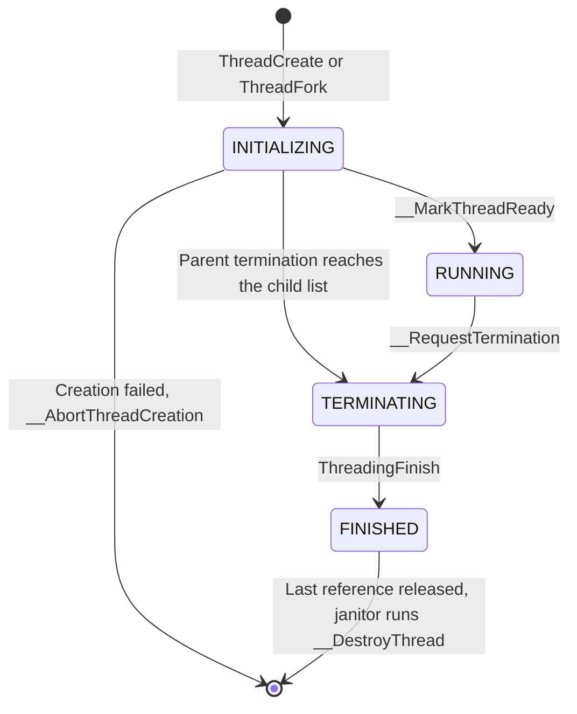
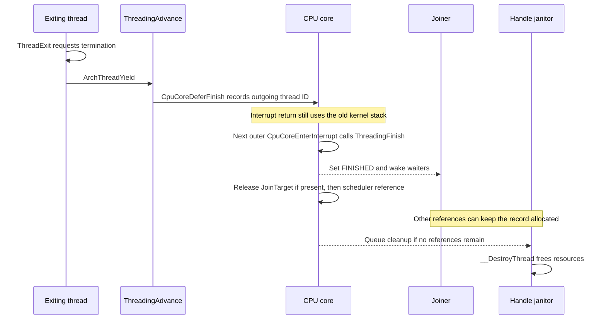

# Kernel thread lifecycle

Status: implemented, 2026-11-11. The tests run on the development host and cover
state changes, exit requests and delayed stack cleanup. They do not boot the
kernel. The system call return path still needs a boot test, including
`ScThreadExit` and completion of a forked system call.

A thread's state says whether it can run or has finished. Its global handle also
has a reference count. Each reference keeps the thread record allocated until
its user releases it, so a thread can be FINISHED while another thread is still
reading its exit code through `ThreadJoin`.

`ThreadExit` requests exit of the calling thread and never returns.
`ThreadTerminate` requests exit of another thread. Both process attached children
as well. The scheduler and CPU interrupt code call `ThreadingFinish` after the
thread's stack is unused. That step wakes joiners and releases the scheduler's
reference. Final resource cleanup runs later on the handle janitor, the kernel
thread responsible for freeing resources whose last reference has been released.

The implementation is in [threads.c](threads.c). Public calling rules are in
[threading.h](../include/threading.h), and internal state and scheduler cleanup
are declared in [private.h](private.h).

## States

Use the named states when testing `Thread_t::State`. RUNNING has value zero,
and INITIALIZING is declared last, so numeric order and boolean tests do not
describe the order of execution.



| State | Meaning | Set by |
|---|---|---|
| INITIALIZING | The record is being built. An ID may already exist, but public operations treat the thread as unavailable. | `ThreadFork`, `__InitializeDefaultsForThread` |
| RUNNING | The thread can execute. This also covers time spent queued or blocked in a wait. | `__MarkThreadReady` |
| TERMINATING | Exit was requested and `RetCode` is stored. The thread may still be using its kernel stack. | `__RequestTermination` |
| FINISHED | The thread cannot run again and its stack is unused. Joiners can read `RetCode`. | `ThreadingFinish` |

Keep state writes in these routines. Creation initializes the field, then
`__MarkThreadReady` replaces INITIALIZING only. If a parent termination request
has already marked the child TERMINATING, the creator keeps that state and
still queues the thread so the scheduler can finish it.

`__RequestTermination` requires the thread's `SyncObject` mutex. It replaces
RUNNING or INITIALIZING and reports the previous state. An existing TERMINATING
or FINISHED state is left unchanged. `ThreadingFinish` requires TERMINATING
before it sets FINISHED.

## Creating and looking up a thread

`CreateGlobalHandle` gives a new thread its first reference. While setup is in
progress, a failed allocation is handled by `__AbortThreadCreation`. Before a
handle exists, that function calls `__DestroyThread` directly. After registration,
it releases the handle and leaves cleanup to the janitor.

Once the creator queues the thread, the first reference becomes the scheduler
reference. The thread can run on another core immediately. It can even finish
and disappear from lookup before `ThreadCreate` returns its ID to the caller.
The output ID adds no reference.

A global thread ID identifies a record. Process permissions are checked
separately. For example, `ThreadJoin` requires the caller and target to share a
memory group, the process-wide data identified by `GroupGlobalHandleID` in their
memory spaces. `ScThreadSignal` makes the same check before calling `SignalSend`.
The kernel's `ThreadTerminate` performs no process relationship check, so its
caller must decide whether ending that target is allowed.

Callers must keep the record valid while using a returned `Thread_t*` or a
pointer inside it, since these accessors add no reference. A temporary
`AcquireGlobalHandle` reference must be paired with `ReleaseGlobalHandle` after
use. The current thread already has its scheduler reference.

## Requesting exit

Call `ThreadExit(code)` from a non-idle thread in thread context. It can block
while taking child-list mutexes. After requesting exit of attached children and storing its own code and state,
it yields, then waits for a scheduling interrupt if the yield returned without
a switch. It cannot return to its caller.
The kernel entry wrapper, `ScThreadExit` and the copied-system-call completion
path in [entry.c](../api/entry.c) use this operation.

`ThreadTerminate(id, code)` also runs in thread context and can block while it
walks the attached children, keeping a temporary reference to the target until
that work is done. The caller's own ID returns
`OS_EINVALPARAMS`, a missing or INITIALIZING target returns `OS_ENOENT`, and an
idle target returns `OS_EPERMISSIONS`. A successful request returns before the
target is necessarily FINISHED.

Both operations walk children before marking the parent. Each newly marked
thread gets the supplied code. An earlier request keeps its exit code and its
child list is not visited again. A blocked target is made ready for scheduling,
so it can reach `ThreadingFinish`. An INITIALIZING child waits for its creator
to queue it. If the calling thread is itself below the target in the child list,
it can be marked TERMINATING by that walk and continues until a scheduling switch.

## Joining and detaching

`ThreadJoin(id, &code)` waits for FINISHED, then copies the target's exit code.
The output must be writable. Self-join and a target with no parent return
`OS_EINVALPARAMS`. An INITIALIZING or missing target returns `OS_ENOENT`, and
threads in different memory groups return `OS_EUNKNOWN`.

The joiner records its target reference in `JoinTarget` before scheduling can
interrupt it, so `ThreadingFinish` can release that reference if the joiner is
terminated while waiting. Otherwise the joiner
clears `JoinTarget` and releases the reference before returning.

The futex wait checks `State` before sleeping and only blocks if it still has
the value that the joiner just read.
A target that finishes between the read and the wait changes that value, so
the joiner cannot miss completion and sleep after the wake has already happened.

Call `ThreadDetach(id)` as the parent or a thread in the same memory group to
remove the target from its parent's child list and clear `ParentHandle`.
Detach before the parent requests exit if the child must keep running. It does
not undo an existing termination request. New joins fail after the parent ID is
cleared, but a join that already passed that check continues waiting.

## Waiting until the stack is unused

`ThreadingAdvance` runs during the scheduling interrupt. Selecting the next
thread updates the core's current-thread pointer and return context, but the
interrupt return code still uses the outgoing thread's kernel stack for a while.
That stack must remain allocated until the return has completed.



For the outgoing thread, `CpuCoreDeferFinish` stores the ID in `PendingFinish`.
The scheduler reference stays valid. The next outer interrupt entry, entered while no other interrupt handler is
active on the core, can finish it because the preceding return has already
switched stacks. Nested entries leave `PendingFinish` alone. They may still use
the old stack. Each core has one pending slot. It is cleared before finishing.

For a TERMINATING thread taken from a run queue, no core is using its stack,
so `ThreadingAdvance` calls `ThreadingFinish` immediately and selects another thread. This also covers a child marked TERMINATING before it first ran.

Call `ThreadingFinish` only from these scheduler and interrupt paths. The thread
must be TERMINATING, absent from all run queues and no longer using a stack on
any core. It sets FINISHED, wakes all joiners, releases `JoinTarget` if present,
and releases the scheduler reference. The function must not block. Code that
needs the record afterwards must hold a separate reference.

## References and resource cleanup

| Reference | Added by | Released by |
|---|---|---|
| Scheduler | `CreateGlobalHandle` during creation | `ThreadingFinish`, or `__AbortThreadCreation` if setup fails |
| Join target | `ThreadJoin`, recorded in the joiner's `JoinTarget` | The joiner on return, or `ThreadingFinish` if the joiner is terminated |
| Signal delivery | `SignalSend` before queuing the signal | `__DeliverSignal` on the target core, including when the target has begun terminating |
| Temporary thread use | Termination, detach, relationship checks, signal permission checks, memory inspection and parent lookup during cleanup | The operation that added it, after its last use |

The parent-child list adds no handle references. The parent's mutex protects
its links. Before freeing a child record, `__DestroyThread` removes it from that list by
taking the parent mutex without holding the child's mutex, following the same
parent-before-child order used by recursive termination.

The last reference release makes the ID unavailable to further lookup and
queues `__DestroyThread` on the handle janitor. Cleanup removes the scheduler
object and stacks, releases the memory space reference, and frees the remaining
thread resources. This happens outside the interrupt that marked the thread
FINISHED, so cleanup can wait for the parent's mutex.

`ThreadExit` must not add a reference to itself. It already has the scheduler
reference, and it will never return to release an additional one.

Signal delivery uses a separate callback reference that can last beyond
`SignalSend`, since `TxuMessageSend` queues the callback before sending an
interrupt to the remote core. Even if the interrupt send reports an error, the
callback stays queued and must release that reference if it runs later. Releasing
it in the sender as well could leave the callback pointing at a freed thread.

## Known gaps

After the last reference is released, a late join cannot recover the exit code
because the ID is already unavailable, even if the janitor has not freed the
record yet.
Check 4 in [thread_identifier_test.c](../../testing/arm64-kernel/thread_identifier_test.c)
checks the resulting `OS_ENOENT`. Keeping finished threads until they are joined
or detached remains undecided.

If an already marked thread calls `ThreadExit` and takes its own mutex with
interrupts enabled, a timer tick before the state check can finish that thread
while it still holds the mutex. Another termination request
waiting for the same mutex then has no thread left to unlock it. Disabling
interrupts around the final state write only covers the first local request.
It does not close this earlier window.

Children added after a thread was marked TERMINATING are not covered by that
request. A repeated request returns before visiting the child list again.

## Tests

Run from the repository root:

```sh
bash testing/arm64-kernel/test_thread_lifecycle.sh
```

The script builds four test programs and runs them under `qemu-aarch64`.
[thread_identifier_test.c](../../testing/arm64-kernel/thread_identifier_test.c)
checks exit requests, join and detach, partial creation cleanup, child-list
removal and signal references.
[thread_lifecycle_test.c](../../testing/arm64-kernel/thread_lifecycle_test.c)
checks scheduler selection and the handoff to `CpuCoreDeferFinish`.

[cpu_finish_test.c](../../testing/arm64-kernel/cpu_finish_test.c) runs the real
`CpuCoreDeferFinish` and `CpuCoreEnterInterrupt`. It checks that a pending thread
is finished once at the next outer entry, that nested entries leave it alone,
and that the slot is cleared before `ThreadingFinish` runs.
[thread_context_test.c](../../testing/arm64-kernel/thread_context_test.c) checks
that copying an ARM64 kernel stack maps all reserved pages and adjusts the saved
stack addresses in the new context.

These checks use replacements for parts of the kernel. They do not verify the
full system call return path, real interrupt timing or the known gaps above.
