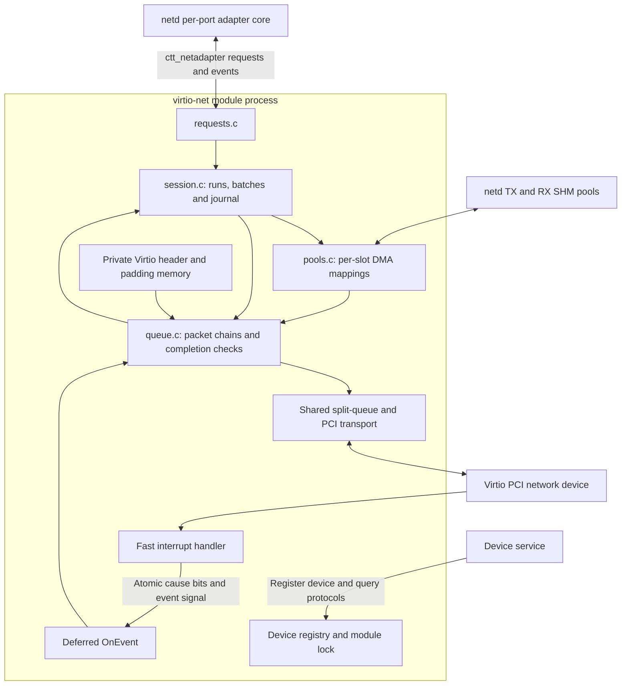
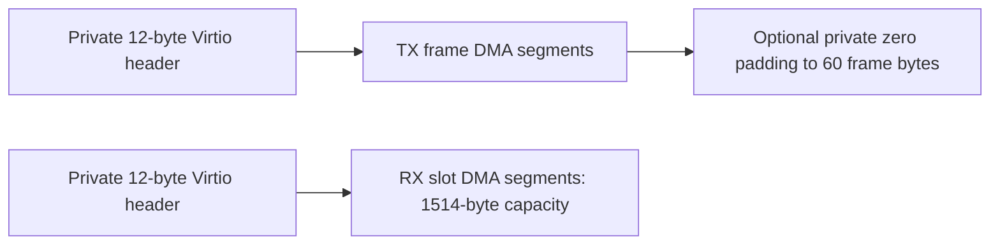

# Driver architecture

[Documentation index](README.md)

## Boundaries

netd controls the adapter session and manages its packet tokens. The driver
controls hardware queue state and DMA access. The shared Virtio library handles
PCI capabilities, status registers and split rings. It does not implement the
network adapter protocol or the completion journal.

`get_info` exposes only port zero. The module can register multiple PCI devices;
each `VirtioNetDevice_t` has its own session, queues, metadata and close history.
The module lock serializes operations across all those devices.

## Device setup and supported features

[virtio-net.yaml](../virtio-net.yaml) matches vendor `0x1af4`, device IDs `0x1000`
and `0x1041`. The implementation uses modern PCI capabilities and requires
`VIRTIO_F_VERSION_1`; matching a PCI ID alone does not imply legacy transport
support.

`VirtioNetDeviceCreate` initializes the common PCI transport and its DMA context,
negotiates features, reads MAC/link state, allocates private packet metadata and
registers the interrupt. Packet queues are created later by `prepare_run`.

Network feature negotiation requires `VIRTIO_NET_F_MAC` and accepts
`VIRTIO_NET_F_STATUS` when available. The common transport adds `VERSION_1`.
The network driver does not request checksum/segmentation offloads, merged RX,
multiqueue, packed rings, indirect descriptors or event-index notification.
Capability support in the shared library does not enable a feature unless this
driver negotiates it.

MAC and link are read between two configuration-generation reads. A changing
generation causes a retry, bounded to eight attempts. The MAC must be nonzero
and unicast. Without `STATUS`, the driver treats the link as up. Speed remains
unknown (zero) and duplex remains `UNKNOWN`.

## Execution and interrupts

`OnLoad` registers the generated `ctt_driver` and `ctt_netadapter` server
protocols. It sets a 1 ms module send timeout before serving clients so a full
netd inbox cannot block device work indefinitely.

All adapter request handlers and `OnEvent` take `VirtioNetLock`. Internal session,
pool and packet helpers require that lock. Registry lookups yield temporary
pointers that must not outlive the protected operation. Shared queue internals
also protect their own mutable descriptor state with a spinlock; PCI
configuration has its own common-library synchronization.

The fast interrupt handler does not take the module lock, poll rings, inspect
packets or emit protocol events. It uses only registered interrupt resources:

1. For MSI-X, record both queue and configuration causes because one vector is
   shared. Otherwise, read the ISR byte and ignore interrupts with no cause bits.
2. Atomically OR the causes into `PendingStatus`.
3. Signal the registered event descriptor.

The module runtime dispatches that descriptor to `OnEvent`. Under the module
lock it consumes the signal and cause bits, calls `VirtioNetPoll`, and checks
configuration/device status when needed. A recognized interrupt event remains
consumed even if processing discovers a device error.

Polling handles at most 64 used entries per queue per call. Reaching that budget
sets the queue cause again and signals another turn. A poll checks RX and TX and
pushes the newly recorded completions without waiting for a full batch. It runs
only for an active `RUNNING` session. Recovery drains also invoke it, allowing
progress after a missed hardware interrupt.

## Memory and descriptor layout

There are three distinct kinds of device-visible storage:

| Storage | Allocation and lifetime |
| --- | --- |
| netd packet pools | SHM allocated by netd, attached by the driver and mapped once per slot at registration. Mappings survive stop/restart and end at unregister/close. |
| Private packet metadata | Driver DMA allocation: 4 pools x 32 slots x 64 bytes = 8192 bytes per device. Contains Virtio headers and initialized TX padding; never shared with netd. |
| Split-ring storage | Common queue DMA allocations for descriptors, available ring and used ring. Created for each run and destroyed after successful reset and queue cleanup. |

Each 64-byte metadata cell must fit within one device DMA segment. The complete
metadata allocation may span several segments. `VirtioNetMetadataAddress`
resolves the cell's actual segment address; it does not add an arbitrary offset
to the first segment.

Each packet slot has an independent `DMAMapping`. Physical SHM geometry is used
only to detect aliases. Descriptor addresses come from DMA mappings, so translated
or bounced memory does not get confused with CPU physical addresses. A slot may
span several DMA segments even though the adapter contract describes one logical
packet region.

TX descriptors are device-readable; RX descriptors are device-writable. The
chain has one private header descriptor, up to 34 frame-data descriptors and,
for short TX, one padding descriptor. `VirtioNetHeader_t` is statically checked
as 12 bytes. No header bytes are inserted into the client's Ethernet frame.

`DMABeginTransfer` precedes descriptor publication. `DMAEndTransfer` follows a
validated used entry or a successful reset, before software reads RX bytes or
reports the packet complete. Mapping setup and packet handoff are separate;
normal packet submission does not allocate another mapping.

The common queue publishes a chain by writing descriptors and the available-ring
entry, executing `dma_wmb`, then advancing the available index. The slot pointer
is the chain's private completion context. A failed notification after that index
write cannot safely undo publication.

## Advertised limits and actual queue capacity

The values come from `__DescribeDevice` and [virtio-net.h](../virtio-net.h).

| Property | Current value |
| --- | --- |
| Contract version / ports | ABI 2 only / one port per device. |
| Framing / medium | Ethernet / virtual. |
| MTU / maximum frame | Fixed 1500 / 1514 bytes. |
| Alignment / client headroom and tailroom | 1 byte / zero. Private headers use separate storage. |
| Optional adapter features | None; only unicast plus broadcast filtering. |
| Queue pairs / contract segments | 1 / 1. RX hardware queue is 0, TX hardware queue is 1. Contract packet `queue_id` is 0 in both directions. |
| Pool registrations | 4 over the session lifetime; at most one mapped pool per direction at a time. |
| Pool size / total registered bytes | 128 KiB per attached SHM object; advertised total 256 KiB. |
| Slots / outstanding packets | Up to 32 per pool / 32 per direction. |
| Minimum posted RX | 4 accepted descriptors before start. |
| Batch size / replay window | 16 records / 4 unretired batches. |
| Completion journal | 128 final results, with capacity reserved for outstanding packets. |
| Requested split-ring size | 128 descriptors per queue; the common queue may choose a smaller supported size. |

Descriptor count is not packet count: one packet can consume several descriptors.
`VirtioNetQueuesPrepare` checks that the actual RX ring can hold the worst-case
chains for four RX packets, and the TX ring can hold at least one worst-case TX
chain. Other queue pressure can still reject individual packets with `OS_EBUSY`.
The fixed protocol limits do not promise that 32 arbitrary fragmented packets fit
simultaneously in a hardware ring.
