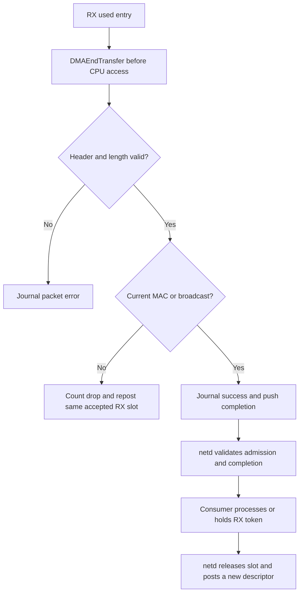

# Flows between netd and Virtio

[Documentation index](README.md) · [netd common flows](../../../../services/netd/docs/flows.md)

## Discovery and run startup

The device service registers a matching bus device through `ctt_driver`.
`main.c` validates the converted bus description, suppresses duplicate device
IDs and calls `VirtioNetDeviceCreate`. Only a successfully created device enters
the active registry and answers protocol discovery with `SERVICE_CTT_NETADAPTER_ID`.
The device service then exposes it to netd's protocol discovery/subscription.

```mermaid
sequenceDiagram
    participant N as netd adapter worker
    participant R as requests.c
    participant D as Session and pools
    participant V as Virtio PCI and queues
    N->>R: get_info(device, port=0)
    R-->>N: ABI 2, MTU 1500, batch/window limits
    N->>R: open(features=0)
    R-->>N: session identity and link
    N->>R: register_pool(TX), register_pool(RX)
    R->>D: Attach SHM; validate aliases; map each slot
    R-->>N: Pool IDs
    N->>R: configure(1500, unicast+broadcast)
    R-->>N: status
    N->>R: prepare_run(1)
    R->>V: Reset/negotiate; create RX queue 0 and TX queue 1
    R-->>N: PREPARED
    N->>R: post_rx_batch(run, batch IDs)
    R->>D: Reserve results and save admissions
    D->>V: Publish writable RX chains
    R-->>N: batch_admitted
    Note over N: Resolve all startup admissions; minimum four RX slots
    N->>R: start_run(run, final admitted batch ID)
    R->>V: Restore configuration vector; set DRIVER_OK
    R-->>N: RUNNING
```

netd normally allocates 32 slots per direction. With this driver's 16-record batch
limit, posting 32 RX slots takes two batches when resource limits allow it.
The required minimum is four, not 32. Queues may contain RX descriptors before
start, but `DRIVER_OK` is delayed until `start_run` validates the run and fence.

Sources: [main.c](../main.c), [device.c](../device.c),
[requests.c](../requests.c), [queue.c](../queue.c),
[netd scheduler](../../../../services/netd/adapters/scheduler.c).

## TX: shared frame to final callback

Precondition: netd and the driver are running the same session/run and link is up.
The consumer has queued a complete Ethernet frame through `NetworkAdaptersSend`
or the direct TX API.

1. netd prepares a pool descriptor, saves the batch for replay and sends
   `submit_tx_batch`. The driver validates ACKs, batch identity and each packet.
2. For an accepted packet, the driver reserves completion space and builds a
   chain: zeroed private Virtio header, frame DMA segments, then private zero
   padding if frame length is below 60 bytes. netd's frame is not modified.
3. `DMABeginTransfer` prepares the frame mapping, then `VirtioSplitQueueSubmit`
   publishes the chain with the slot as its context. Admission results return
   through `batch_admitted`.
4. Hardware reads the chain and writes a used-ring entry. The interrupt wakes
   deferred polling. The common queue validates the returned chain and returns
   its context.
5. The network driver ends the DMA transfer. A TX used length other than zero is
   a protocol error. Otherwise it journals success with the original unpadded
   frame length and pushes a completion event.
6. netd resolves admission/completion, invokes `Transmitted(cookie, status)` and
   returns the slot to its pool. Acknowledgements separately retire batch and
   journal records.

```mermaid
sequenceDiagram
    participant N as netd
    participant D as virtio-net
    participant V as Virtio device
    N->>D: submit_tx_batch
    D->>D: Validate and reserve journal capacity
    D->>V: Publish header + frame + optional padding
    D-->>N: batch_admitted
    V-->>D: Used entry and interrupt
    D->>D: End DMA; journal terminal result
    D-->>N: completions(request_id=0)
    N->>N: Transmitted callback; release local slot
    N->>D: acknowledge contiguous prefixes
    D-->>N: ack_progress
```

Admission and completion events need not be received in diagram order. netd
handles completion-before-admission. TX success establishes that the device
finished reading the memory; it is not an acknowledgement from a network peer.

Sources: [session.c](../session.c), [queue.c](../queue.c),
[common queue publication](../../common/queue.c),
[netd TX](../../../../services/netd/adapters/tx.c).

## RX: used entry to consumer packet

The driver accepts `post_rx_batch` during preparation/running and publishes
writable header and frame descriptors. Its private header is separate from
netd's slot. On completion:

1. Poll the RX ring and end the slot DMA transfer. For a length within the
   header-plus-frame bound, return only that frame prefix through the DMA API
   before reading it; invalid lengths use a zero completed prefix.
2. Validate total used length (12-byte header plus 14..1514 frame bytes), zero
   `Flags`/`GsoType`, and `NumBuffers <= 1`. A malformed result becomes a packet
   error completion with `OS_EPROTOCOL` and no payload.
3. Inspect the destination MAC in the now-readable SHM. The filter accepts the
   current device MAC or broadcast.
4. For accepted traffic, journal the actual frame length and send completions.
   netd delivers the frame through its packet or temporary-byte callback.
5. For another destination, increment `rx_dropped` and repost the same slot
   internally. There is no terminal adapter completion for the discarded frame;
   the original accepted RX request still has its reserved completion capacity.
   Repost failure either produces an error result or faults the session if access
   is uncertain.
6. Once netd has a successful RX completion, the driver cannot touch that slot
   until netd explicitly posts it again with a new submission sequence. netd may
   hold the pool packet, copy it into its bounded RX copy storage, or process it
   only during the callback.



Sources: [queue.c](../queue.c), [pools.c](../pools.c),
[netd RX](../../../../services/netd/adapters/rx.c).

## Lost events, ACKs and drain

A lost admission event is recovered by identical batch replay. The driver returns
saved descriptor results; it does not run DMA a second time. A failed completion
send leaves the final result in the journal until a valid completion ACK.

For a missing completion or periodic recovery, netd sends a new `drain` request
with its contiguous processed sequence. The driver:

1. Rejects an unmatched session or a duplicate/older drain request ID without
   sending an event. A newer ID becomes the latest attempt even if later
   validation fails.
2. Calls `VirtioNetPoll` first, recovering hardware progress after a missed IRQ.
   This can emit independent live completion events.
3. Applies valid ACKs, then checks `after_sequence` against retired/highest
   progress and validates a limit of 1..16.
4. Copies at most 16 consecutive journal records into a local array while holding
   the module lock. This implementation emits at most one recovery chunk, followed
   by `drain_end`, even for an empty or failed enumeration.
5. Leaves records in the journal until ACK. Failed event delivery does not alter
   the saved packet results. A missing chunk/end makes netd start a new attempt.

Live events use request ID zero; recovery chunks use the drain attempt ID. netd
deduplicates both by completion sequence and waits for the selected prefix as well
as the end marker. Standalone `acknowledge` always emits `ack_progress` for a
matching session, including duplicate ACKs, so idle retirement can recover too.

Source: [requests.c](../requests.c), [session.c](../session.c),
[netd recovery](../../../../services/netd/docs/recovery-and-lifecycle.md).

## Link and fault events

A configuration interrupt checks `DEVICE_NEEDS_RESET`/`FAILED` and reads a coherent
MAC/link snapshot. A changed carrier increments the link sequence and emits
`link_changed` for an active session. `get_link` also rereads configuration; the
event itself is best effort. Link-down blocks new TX admission but is separate
from administrative run state.

`VirtioNetFault` sets `Faulted` once per active session and emits `fault`. It does
not reset the device or return packet memory. netd's current event handler
requests close when the session matches; it does not preserve the fault payload
in its snapshot. Fault event loss remains subject to later request/recovery
behavior, rather than proving successful shutdown.
