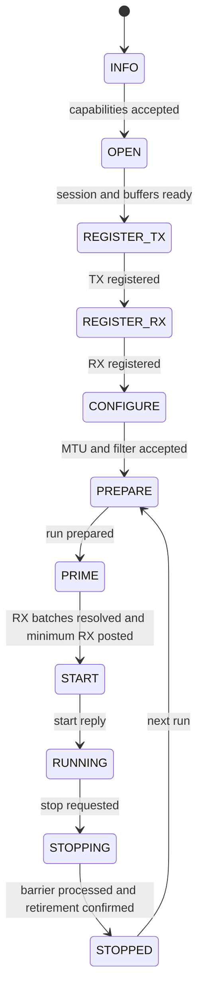

# Adapter infrastructure

[Documentation index](README.md)

## Layers and state

The registry identifies a port by `(device UUID, port number)`. Its `AdapterEntry`
contains the current driver, dedicated Gracht client, pending replacement driver
and transport reply state. A `NetworkAdapter_t` contains one port's protocol
session and packet state.

| Layer | Main state | Responsibility |
| --- | --- | --- |
| Registry and transport | `AdapterEntry` | Discovery, serialization, client endpoint, attachment and removal. |
| Session core | `NetworkAdapter_t`, `AdapterIntent`, `AdapterControl` | Lifecycle, caller requests and one outstanding control operation. |
| Batch/recovery scheduler | `AdapterWindow`, `AdapterAck`, `AdapterDrain` | Batches awaiting retirement, ACK deadlines and missing completions. |
| Packet queues | `AdapterLease`, `AdapterTx`, `AdapterRx` | Caller tokens, queued TX, RX delivery and fixed copy storage. |
| Buffer manager | `NetBufferManager_t` | SHM regions, slot state, lease sequences and completion capacity. |

The structures are in [private.h](../adapters/private.h),
[lease.h](../adapters/lease.h) and [buffers.c](../adapters/buffers.c).

## Identities

Several counters solve different problems. They must not be substituted for one
another or reset together when a run stops.

| Identity | Meaning |
| --- | --- |
| Session `(id, generation)` | Selects the exact driver session. Both values must be nonzero. |
| Run ID | Selects a prepared/running interval within the session. Starts at one and increases on restart. |
| Batch ID | Orders TX and RX publications together across all runs of the session. |
| Packet ID | Queue, pool, slot and submission sequence identify one use of a slot. |
| Local lease sequence | Rejects stale or repeated local release/submit operations after slot reuse. |
| Completion sequence | Orders final packet results across TX and RX for the whole session. |
| Control serial | Matches a core reply to the currently pending logical request. |
| Gracht message ID | Routes a transport reply; each resend gets a new transport message. |
| Drain request ID | Identifies one recovery enumeration attempt; each retry uses a new ID. |

Batch replay keeps the same session, run, direction, batch ID and descriptor
array. Piggybacked ACK cursors may advance. Registration replay keeps its
registration key and pool description. Counters do not wrap; exhaustion must
fail or close safely instead of making an old message appear current.

## Session startup

This diagram shows the normal path. Close and error paths are described in
[Recovery and lifecycle](recovery-and-lifecycle.md).

`get_info` must include ABI 2 and usable limits. Automatic MTU selection starts
with `min(current_mtu, 1500)`, raises it to the driver minimum if needed, then
validates the result. An explicit configured MTU is validated without silently
changing it. `open` requests zero optional features and returns the initial link
snapshot. Pool setup occurs only after a valid session and link reply.

netd registers TX and then RX, using registration keys 1 and 2. It configures MTU
and receive filters, prepares run 1, and posts RX batches before `start_run`.
All published startup batches must have known admission results, and at least
`min_rx_slots` must be outstanding. The start request carries the admitted batch
cursor as its fence. Administrative `RUNNING` and physical link `UP` are separate;
TX requires both.

## Shared pools and slot layout

Each port allocates one TX pool and one RX pool. A pool is a shared region split
into fixed-size slots. Each slot reserves aligned frame space plus the driver's
required headroom and tailroom. Page-rounded SHM, buffer-manager records, lease
tables, session state, completion tracking and RX copy storage are checked against
the configured memory budget. Allocator/kernel bookkeeping is outside that budget.

The driver receives SHM handles and offsets. It prepares mappings or bounce
buffers; a CPU pointer returned to the consumer is not a DMA address. Adjacent
slots in the region need not be physically adjacent.

Pool registration is marked in progress **before** sending the RPC. From that
point, even a missing reply can mean the driver is using the region. The region
stays allocated until successful unregister or confirmed session close, followed
by release of all local packet tokens. The current session scheduler uses close
for teardown; it does not issue `unregister_pool` during normal shutdown.

## Two levels of packet state

The buffer manager tracks whether CPU or driver access is permitted:

| Buffer state | Meaning |
| --- | --- |
| `SLOT_FREE` | Available from the free list. |
| `SLOT_HELD` | Reserved locally; CPU access is permitted. |
| `SLOT_PENDING` | Descriptor prepared; admission is not yet known. |
| `SLOT_DRIVER` | Driver accepted the descriptor and has not completed it. |
| `SLOT_READY` | Final result recorded; CPU access/release also requires resolved admission. |

The usual path is `FREE -> HELD -> PENDING -> DRIVER -> READY -> FREE`.
Rejection changes `PENDING` back to `HELD`. A completion may arrive before its
admission and produce `READY` with admission still unresolved. That slot cannot
be delivered or released yet. A rejected descriptor needs a fresh lease and
submission sequence before a new submission.

The adapter queue separately tracks local responsibility:

| Queue state | Meaning |
| --- | --- |
| `ADAPTER_LEASE_TX_BUILDING` | Caller is writing a direct TX packet. |
| `ADAPTER_LEASE_QUEUED` | TX awaits batching, or RX is being added to a batch. |
| `ADAPTER_LEASE_PREPARED` | Descriptor belongs to a batch that may have reached the driver. |
| `ADAPTER_LEASE_RX_RETAINED` | Consumer accepted an RX pool packet and must release it later. |
| `ADAPTER_LEASE_FREE` | No active local packet for this slot. |

A `PREPARED` queue entry is not proof of driver admission. Buffer state, admission
and completion checks still decide whether it can be reused. Pool slots are
zeroed when taken for a new lease, including padding.

## Batches, completion records and available capacity

Batch submission is one-way. A successful transport send only publishes the
request. `batch_admitted` provides one ordered result per descriptor. A consumed
batch can contain accepted and rejected descriptors; a successful batch status
alone does not mean all packets were accepted.

Accepted descriptors each produce one logical final completion. Delivery may
repeat or arrive out of order. netd validates event contents before applying
them, checks packet identities, and deduplicates completion sequences. TX success
means the device finished reading the frame, not that a remote peer received it.

Two cumulative ACK cursors advance only across a contiguous processed prefix:

- Batch ACKs allow the driver to discard saved admission results.
- Completion ACKs allow it to discard saved final results.

Neither ACK substitutes for packet completion or resolves an unknown admission.
Sending an ACK does not restore capacity locally: validated driver progress must
confirm retirement. netd keeps batch descriptors/results until that confirmation.
Admission replay storage can be retired while packets from that batch are still
with the driver.

New work is limited by free pool slots, per-direction outstanding limits,
completion-record capacity and the unretired batch window. RX posting reserves at
least one completion position for TX. The scheduler alternates RX and TX when
both can publish, and handles ACK/drain work even while a control query is pending.
See [scheduler.c](../adapters/scheduler.c) and [events.c](../adapters/events.c).

## Defaults and bounds

| Setting | Current default or bound |
| --- | --- |
| Registry entries | 16 total port entries across devices. |
| Requested TX / RX slots | 32 / 32, capped by driver limits. |
| Memory budget | 1 MiB per session for packet resources and associated core bookkeeping. |
| Batch window | 4 requested; hard core maximum 8; also capped by driver. |
| Records per batch | At most 44; also capped by driver. |
| Gracht frame size | At most 2048 bytes, including its 11-byte header. |
| Retry interval / send limit | 1000 ms / 3 sends including the initial attempt. |
| Completion recovery poll interval | 100 ms while packet work is outstanding. |
| RX pool packets held by consumers | Up to 8 requested, reduced to leave the driver minimum or at least one pool slot. |
| RX copy slots | Up to 8 requested, capped by RX slot count; allocated at setup. |
| Failed local attachment retry | At most once per second. |

Defaults are defined in [adapter.h](../adapters/adapter.h) and
[private.h](../adapters/private.h); negotiated sizing is in
[queue.c](../adapters/queue.c). The adapter pool and queue path preallocates packet
storage. This does not imply that Gracht, the driver, consumer code or local socket
transfers perform no allocations.
