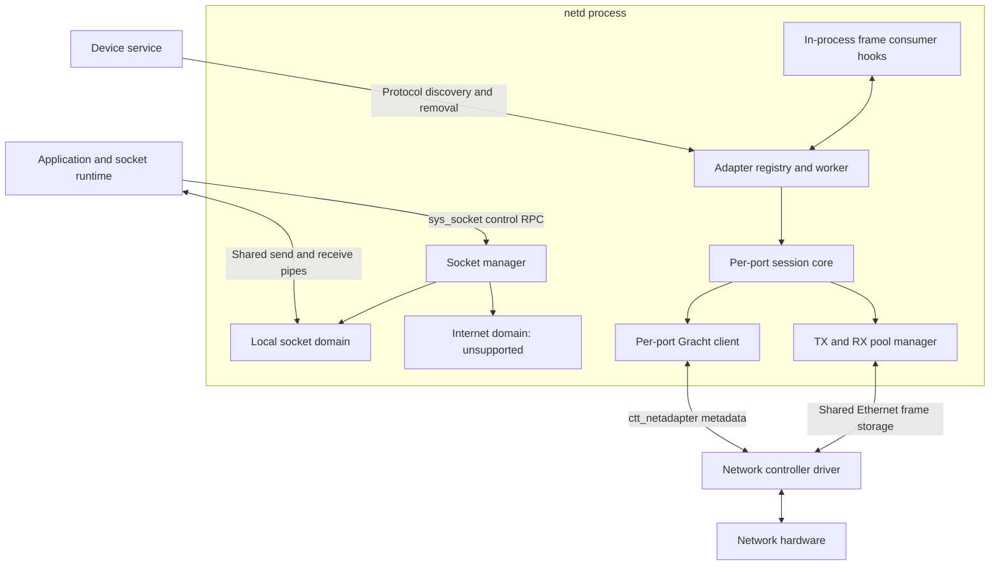

# Service architecture

[Documentation index](README.md)

## Service boundaries

The socket manager and adapter manager are separate subsystems. There is currently
no implemented Internet domain connecting them. The adapter hooks are an
in-process interface for a frame consumer, not a public socket RPC or a separate
network stack process. The IPC and Virtio test workloads install these hooks;
normal [service startup](../main.c) does not.

The device service reports the device UUID and driver endpoint. netd creates one
session per device port. The controller driver implements hardware queues,
interrupts and DMA mappings. netd supplies Ethernet frame storage and tracks when
it can read, write or reuse that storage.

## Protocols and data paths

| Interface | Direction | Purpose |
| --- | --- | --- |
| [sys_socket](../../../protocols/net.gr) | Socket clients to netd | Create, pair, bind, listen, connect, accept, query and close sockets. |
| [sys_device](../../../protocols/device.gr) | netd to device service; events back to netd | Subscribe to device changes and discover `SERVICE_CTT_NETADAPTER_ID`. |
| [ctt_netadapter](../../../protocols/contracts/netadapter.gr) | netd to controller; replies/events back to netd | Capabilities, sessions, pool registration, run control, batch submission and completion recovery. |
| `NetworkAdapters*` | Other code inside netd | Send frames, install callbacks, return packets and request lifecycle changes. |

Socket payloads use shared stream buffers created by [socket.c](../socket.c).
The client-side pipe and notification code is in [libos/services/net.c](../../../librt/libos/services/net.c).
The socket RPC returns the socket handle and two SHM handles. The socket monitor
transfers outgoing local data into the destination socket's receive pipe.

Adapter payloads use different SHM pools. Gracht messages contain pool handles,
packet offsets, lengths and identifiers, not Ethernet frame bytes. Queue zero
and one segment per packet are the ABI 2 model. Frames start at the destination
MAC address and exclude preamble and FCS. MTU describes payload size; netd adds
the 14-byte Ethernet header when sizing usable frame storage. Driver headers,
alignment padding and tailroom are outside that frame area.

## Execution contexts

### Socket manager

[manager.c](../manager.c) protects complete socket operations with the recursive
`g_socketExecution` mutex. It covers socket lookup through last use, including
peer lookups and destruction. Code takes it before a socket's `SyncObject`.
Recursion is needed because accepting a local connection creates and pairs a
socket through manager functions.

The `SocketMonitor` thread waits on an OS notification queue. `IOSETOUT` makes a
sender runnable; `IOSETCREDIT` wakes senders waiting for space in a receiver.
Queue links are embedded in socket objects, and duplicate notifications do not
allocate more work entries. Each monitor pass handles bounded work and posts a
new notification if runnable sockets remain.

Local stream, datagram and sequenced-packet transfers use nonblocking pipe
operations inside netd. A full destination pipe queues the unfinished data on the
sender and puts it on the receiver's wait list. Other sockets can then progress.
This wait list is independent of adapter batch and completion limits.

### Adapter manager

[adapters.c](../adapters/adapters.c) starts one scheduler job for all adapter ports.
Each port has a dedicated Gracht client, but there is no worker thread per port.
The shared `g_lock` serializes public API calls, transport polling, session state
changes and callbacks.

Public functions perform local actions under that lock, such as reserving a TX
slot, queuing a frame or setting a stop flag. The worker sends the resulting
protocol requests. Lifecycle API success means the request was recorded; it does
not mean a remote stop or close has completed.

On each pass the worker attempts pending attachments, polls attached ports and
checks cleanup. A transport poll processes up to 16 incoming messages and emits
up to 16 requests for that port. It does not block waiting for an RPC reply. The
worker waits on client descriptors and an explicit wake event; a 10 ms maximum
idle wait also gives timers and attachment retries a chance to run. Exhausting a
work budget causes an immediate next pass. Retry deadlines use monotonic time.

The core `NetAdapter*` API has no internal locks. Its callers must serialize all
access. Host tests can drive it directly without the service or Gracht transport.
Production callers use the synchronized `NetworkAdapters*` wrappers.

## Consumer integration

Install a `NetworkAdapterOps_t` through `NetworkAdaptersSetHooks`. It supplies
`Receive`, `ReceivePacket`, `Transmitted` and `Link` callbacks for all ports.
Each callback includes the device UUID and port number.

Precondition for callbacks: return promptly and never call back into either the
adapter core or `NetworkAdapters*`. Callbacks run synchronously with the registry
lock held. Enqueue accepted packets or completion information into a bounded
consumer queue, then perform further work outside the callback.

`Receive` exposes bytes only for the duration of the call. `ReceivePacket` can
accept a packet for later processing; that packet needs exactly one later
`NetworkAdaptersRxRelease`. A direct TX packet can be filled outside the lock
between `NetworkAdaptersTxAcquire` and submit/cancel. The caller must synchronize
any transfer of the token to another thread.

## Current implementation limits

- `AF_LOCAL` supports stream, datagram and sequenced-packet data paths.
  [Internet](../domains/internet.c), [Bluetooth](../domains/bt.c) and
  [unspecified](../domains/unspec.c) domain constructors return
  `OS_ENOTSUPPORTED`.
- Socket option get/set and directional socket shutdown are unsupported.
  `DESTROY` performs socket destruction. Local connection backlog enforcement
  still has a TODO in `HandleLocalConnectionRequest`.
- Adapter startup requests no optional features and configures unicast plus
  broadcast filtering. The contract does not define packet offloads in ABI 2.
  IP addressing, routing, transport protocols and wireless association are outside
  the adapter contract.
- Dedicated clients and session generations reject misrouted or stale messages;
  they do not authenticate an IPC sender or prove that DMA has stopped. The
  trusted-image limitation for live pool registration is recorded in
  [CMakeLists.txt](../CMakeLists.txt). Contract authentication requirements must
  not be mistaken for guarantees supplied by these netd checks.
