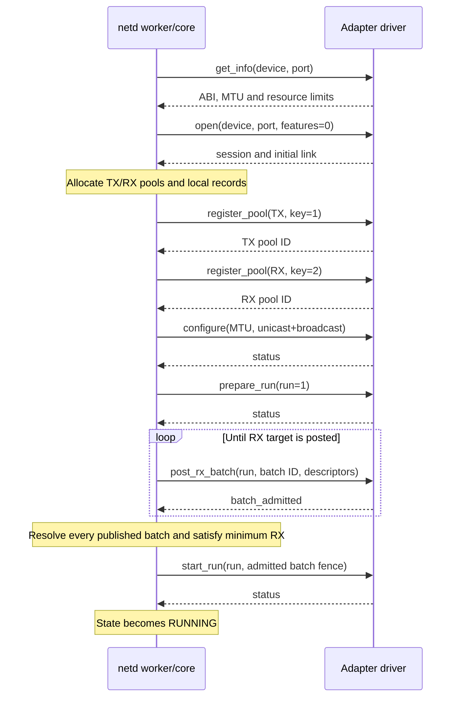

# Common flows

[Documentation index](README.md)

## Service startup and adapter discovery

1. `ServiceInitialize` registers the socket server and device-service client
   protocols, then initializes the socket manager and adapter registry.
2. netd waits up to 1000 ms for the device service. Initialization failure or a
   missing device service terminates startup.
3. It subscribes to device events before requesting all devices advertising
   `SERVICE_CTT_NETADAPTER_ID`.
4. A matching protocol event calls `NetworkAdaptersDiscover(device, driver)`.
   The registry records port zero and wakes the worker. Duplicate discovery for
   the same active driver does not create another session.
5. The worker creates a dedicated client and a core adapter with default limits.
   Local attachment failure leaves the pending driver recorded for a later retry.
6. Port zero's capability reply exposes `port_count`. The worker discovers extra
   ports subject to the shared 16-entry registry limit. Each gets its own session.

Source: [main.c](../main.c), [adapters.c](../adapters/adapters.c).



ACKs and recovery requests may be interleaved; the diagram shows the normal
lifecycle order. Link state is independently reported through `Link`.

## Transmit an Ethernet frame

Preconditions: the selected port is running, link is up, and neither stop nor
close has been requested. Supply a complete frame of at least 14 bytes and at
most the configured MTU plus 14 bytes.

For an existing frame, call `NetworkAdaptersSend`. It copies the frame into a TX
slot. To build directly in shared storage, use the following sequence:

1. `NetworkAdaptersTxAcquire` returns writable `Data`, usable `Capacity` and an
   opaque token. Fill the frame outside the registry lock.
2. `NetworkAdaptersTxSubmit(..., length, cookie)` checks the token, length, link
   and run. Success queues the frame and clears the caller's token.
3. On submit failure, the caller still has the token. Cancel it with
   `NetworkAdaptersTxCancel` or retry only while it remains valid. Cancellation
   clears the token and produces no transmit callback.
4. The worker takes queued TX in submission order, prepares descriptors and
   stores an immutable batch before publishing `submit_tx_batch`.
5. Admission rejection finishes that packet with the reported error. Acceptance
   waits for a completion; a completion that arrives first waits for admission.
6. `Transmitted(device, port, cookie, status)` reports the final result once for
   each locally accepted send/submit, if the callback is installed. The pool slot
   returns to local reuse. ACK progress separately frees protocol record capacity.

```mermaid
sequenceDiagram
    participant C as Frame consumer
    participant N as netd
    participant D as Driver
    C->>N: TxAcquire
    N-->>C: Writable packet token
    Note over C: Fill frame
    C->>N: TxSubmit(length, cookie)
    N-->>C: Queued; token cleared
    N->>D: submit_tx_batch
    D-->>N: batch_admitted
    Note over D: Device reads accepted frame
    D-->>N: completions
    N-->>C: Transmitted(cookie, status)
    N->>D: acknowledge processed prefixes
    D-->>N: ack_progress
```

Transport send, driver admission and final completion are distinct. A timeout
between any of them is not permission to recycle uncertain storage.

Source: [tx.c](../adapters/tx.c), [queue.c](../adapters/queue.c),
[events.c](../adapters/events.c).

## Receive and return a frame

The worker posts RX slots during startup and replenishes them while running.
For RX, the descriptor length is writable frame capacity. The driver fills an
accepted slot and reports actual frame length in its completion.

After validating completion and resolving admission, netd chooses a delivery
path:

1. If `ReceivePacket` exists and the consumer-held pool count is below its limit,
   offer the original pool packet. A `true` result means the consumer stored the
   token and will release it later. That slot is unavailable for reposting.
2. If the pool limit is reached, try a preallocated copy slot and offer that
   packet to `ReceivePacket`. An accepted copy lets the original RX pool slot
   return immediately.
3. If packet delivery is unavailable or declined, call `Receive` when installed.
   Its bytes are valid only during that callback. If neither path consumes the
   frame, increment the RX dropped count.
4. After processing an accepted token outside the callback, call
   `NetworkAdaptersRxRelease`. It validates the token, clears it on success and
   wakes the worker. A pool slot becomes available for reposting; a copy slot
   becomes available for another copy.

Do not release a packet inside `ReceivePacket`; return `false` to decline it.
Do not let multiple users independently release copies of the same token. Held
RX data stays readable through stop, removal and confirmed close, but prevents
final cleanup until released.

Source: [rx.c](../adapters/rx.c), [queue.c](../adapters/queue.c),
[adapters.h](../adapters/adapters.h).

## Link changes

The open reply supplies the initial link snapshot. Later `link_changed` events
are routed through the port's client and checked against its session. The core
validates the link fields and uses the increasing link sequence to avoid reporting
old state again. `Link` notifies the installed consumer of a newer valid snapshot.
Link-down leaves the administrative run state separate, but prevents new TX
build/submit operations. It does not prove that outstanding descriptors completed
or that their storage can be freed.

Source: [client.c](../adapters/client.c), [adapter.c](../adapters/adapter.c).

## Create and connect local sockets

`sys_socket.create` enters the socket manager under `g_socketExecution`.
`SocketCreateImpl` validates the type, creates the domain/address and socket
handle, and allocates separate receive and send pipes. The manager registers
`IOSETOUT | IOSETCREDIT` notifications, adds the socket to its tree and returns
the socket and SHM handles. Failed creation unwinds its created resources.

For a listening local socket:

1. Bind a local address and call listen to mark the socket passive.
2. A stream or sequenced-packet connect resolves the destination and checks the
   types. If an accept is already waiting, it can be matched immediately.
3. Otherwise, the domain stores a deferred connect response and notifies the
   listener with `IOSETCTL`. An accept with no waiting connection similarly
   stores a deferred response when configured to block.
4. Matching connect and accept creates a new socket for the accepting side and
   pairs it with the connector. The domain sends both responses; the accept
   response includes the new socket and pipe handles. The listener stays separate.

`sys_socket.pair` pairs two existing compatible sockets without the listen/accept
exchange. Connect/accept success may be completed by the domain later, so the
manager must not send an additional success response.

Source: [manager.c](../manager.c), [socket.c](../socket.c),
[local.c](../domains/local.c).

## Local socket data and a full receive pipe

```mermaid
sequenceDiagram
    participant S as Sending process
    participant N as Socket monitor/local domain
    participant R as Receiving process
    S->>S: Write shared send pipe
    S-->>N: IOSETOUT notification
    N->>N: Read send pipe and resolve peer
    alt Receive pipe has space
        N->>N: Write peer receive pipe
        N-->>R: IOSETIN notification
    else Receive pipe is full
        N->>N: Save pending bytes or packet; wait for receiver credit
        R->>R: Read shared receive pipe
        R-->>N: IOSETCREDIT notification
        N->>N: Make waiting sender runnable and retry
        N-->>R: IOSETIN after delivery
    end
```

Streams move bytes in chunks and preserve any unwritten suffix. Datagram and
sequenced-packet transfers preserve packet boundaries. The packet path validates
header lengths and destination data, then substitutes the source address only
after reserving destination space. A packet waiting for space therefore still
contains the original destination needed by its retry.

`NETWORK_MANAGER_SEND_BUDGET` bounds each domain send pass to 16 iterations.
`OS_EINPROGRESS` puts the sender back on the runnable queue. The monitor handles
at most 32 runnable entries per pass and schedules another notification when
work remains. Adapter pools and the NIC are not involved in local transfers.

Destroying a socket removes it from the manager tree and work queues under the
execution lock, wakes its waiting senders, removes its notification registration,
disconnects its peer and destroys its pipes/domain/object. Directional shutdown
currently returns `OS_ENOTSUPPORTED` without dismantling the pipes.
