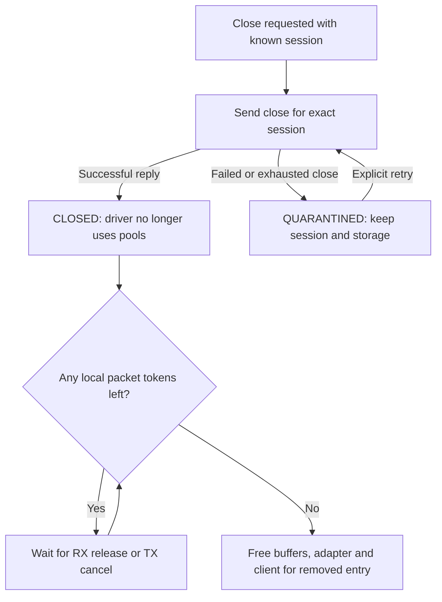

# Recovery and lifecycle

[Documentation index](README.md)

## Request scheduling and retry

[scheduler.c](../adapters/scheduler.c) returns at most one request per
`NetAdapterNextRequest` call. The transport invokes it repeatedly within its work
budget. The scheduler handles pending control deadlines, gives close priority,
applies stop intent, retries overdue batches, sends ACK/drain work, advances
lifecycle/query work and finally publishes new running RX/TX batches.

Only one control transaction is pending at a time. Batch submissions have their
own window, and ACK/drain work has separate state and timers. A pending link or
counter query therefore does not block all packet and recovery traffic.

| Missing result | Recovery |
| --- | --- |
| Control reply | Resend the same logical operation; use a fresh Gracht message ID. |
| Batch admission | Resend the lowest overdue unresolved batch with the same ID and descriptors. ACK fields may advance. |
| ACK confirmation | Resend cumulative cursors until driver progress confirms retirement. |
| Completion chunk or drain end | Start a new drain attempt with a new request ID and the current contiguous completion cursor. |

The default limit is three sends at one-second retry intervals. A send error is
uncertain delivery, not an admission rejection. A late reply must still match
the pending control serial, or the packet/session identities used by events.
An empty nonblocking inbox (`ENODATA`) is normal; it is not driver disconnection.

## Recover missing completions

Normal completions are pushed by the driver. `drain` is the recovery path, not a
required round trip for each packet. Progress reporting can expose a missing
sequence. Periodic drains while packets are outstanding also recover a lost final
event when no later event exists to expose the gap.

1. Send `drain(session, new request_id, ProcessedCompletion, limit, ack)`.
2. The driver sends a bounded snapshot of completion records, plus `drain_end`.
3. Merge live and recovered records by completion sequence. Deliver each packet
   at most once; never advance the processed prefix over a missing sequence.
4. Validate the end marker and wait until all records through its end have been
   processed. The end event can arrive before the chunks and is insufficient by
   itself.
5. Publish the resulting ACK prefix. Only confirmed progress restores the
   corresponding driver record capacity.

If an attempt times out, the next attempt uses a new drain ID and starts after
the current processed prefix. Repeated failures eventually request safe close.
Source: [scheduler.c](../adapters/scheduler.c), [events.c](../adapters/events.c),
[buffers.c](../adapters/buffers.c).

## Stop and restart

`NetworkAdaptersSetRunning(device, port, false)` records stop intent. TX admission
from callers stops immediately; the worker then moves eligible run states into
`STOPPING`.

1. Cancel locally queued TX with `OS_ECANCELLED`. Leave already prepared batches
   intact because the driver may be using their slots.
2. Stop creating new batches and resolve every published batch to a consumed
   admission result. If this cannot be achieved, use close recovery.
3. Send `stop_run` with the current run ID and final admitted batch cursor.
4. A successful reply supplies the run's final completion sequence. Drain and
   process through that barrier, obtain confirmed completion ACKs through it,
   and wait for all admitted batches to be retired.
5. Enter `STOPPED` only when these conditions hold and no TX/RX descriptors remain
   outstanding with the driver.

Stopped sessions keep their registered pools. Link/counter queries remain
available. `NetworkAdaptersSetRunning(..., true)` restarts only from `STOPPED`:
increment the run ID, prepare the next run, prime RX and start again. Batch and
completion sequences remain session-wide and do not reset.

A caller can still hold an RX token or a TX packet being built during stop.
An old TX build token cannot be submitted in the next run; cancel it explicitly.
These local tokens do not grant the driver access to the slot.

## Close and release memory

Close is stronger than stop. `NetworkAdaptersClose` marks the entry for removal
and requests a close. Once a session ID is known, the core can abandon a pending
non-close control request and issue close without completing the normal stop
sequence. If open is still unresolved, its outcome must first be recovered.

A successful close is the driver's guarantee that it no longer accesses any
pool memory. `NetBuffersClosed` marks both pools retired and converts unresolved
driver work into cancelled results. Worker-managed leases are released, with TX
cancellation callbacks where needed. Consumer-held RX packets and TX build
tokens remain valid until explicitly released or cancelled.

`NetAdapterDestroy` returns `OS_EBUSY` while local packets still need storage.
The registry keeps the entry, allowing release/cancel by device and port even
after removal. Returning the last token wakes cleanup. The current code does
not expose a whole-service adapter worker drain/join API; these are per-port
lifecycle rules.

## Failure and quarantine

| Condition | Result |
| --- | --- |
| Failure before a session exists | `FAILED`; no pool registration needs to be undone. |
| Ordinary failure after a session exists | Record `LastError`, request close and move to `CLOSING`. |
| Open retry exhausted or successful open has no usable session identity | `QUARANTINED`; the driver may have opened a session. |
| Close fails or its retries are exhausted | `QUARANTINED`; storage cannot safely be freed. |
| Packet admission rejection | Finish that descriptor locally; do not infer rejection of unrelated packets. |
| Duplicate completion | Ignore repeated delivery without issuing another consumer callback. |

RX admission rejection also delays replacement posting by the retry interval.
Consecutive RX batches with every descriptor rejected count toward the retry
limit; reaching it fails the session with `OS_EBUFFER`. A batch with an accepted
RX descriptor resets that failure count.

Quarantine stops normal request generation. Device disappearance, a fault event,
a newer generation or a timeout is not evidence that the old DMA access ended.
The registry does not free quarantined entries or attach replacements over them.

`NetworkAdaptersRetry` explicitly retries supported recovery states. For a failed
adapter with no session/buffers it returns to capability discovery. For quarantine
with a pending open or close, it resets the attempt budget and retries that same
operation. It does not discard uncertain pools or manufacture a successful close.

## Removal and driver replacement

A device-service disconnect calls `NetworkAdaptersRemove`, clearing pending
drivers and requesting close for every port of that device. Removal is an intent,
not a memory-release barrier.

If discovery reports a new driver for an existing port, the registry records it
as `PendingDriver` and closes the old adapter. It attaches the new driver only
after the old adapter and client have been safely destroyed. Extra ports from the
old driver are also closed; the new port-zero capability reply determines the new
port count. Held local packets or quarantine can therefore delay replacement.

## Inspect progress

`NetworkAdaptersSnapshot` returns cached state immediately and requests fresh
driver counters for a later snapshot. It does not synchronously refresh them.
A discovered entry still waiting for local attachment reports `INFO` with the
remaining snapshot fields zeroed.

Useful distinctions when investigating a stalled port:

- `RUNNING` with link down: new TX is rejected even though run setup succeeded.
- Free TX slots with no new batches: inspect outstanding/completion limits and
  unretired batch count, not just free slot count.
- Increasing processed completions with unchanged acknowledged progress:
  retirement confirmation is missing; local ACK publication alone is insufficient.
- `STOPPING`: check unresolved admissions, the stop barrier and retirement.
- `CLOSED` with delayed replacement: look for RX packets or TX build tokens still
  held by a consumer.
- `QUARANTINED`: inspect `LastError` and recover the pending open/close explicitly.

The core snapshot includes pool statistics, RX copy/drop counts and batch/run
cursors. Driver counters describe device traffic; buffer counters describe local
resource use. They answer different questions.

## Regression coverage

| Tests | Scope |
| --- | --- |
| [net_buffers_test.c](../../../testing/net_buffers_test.c) | Pool layout, lease transitions, registration and completion accounting. |
| [net_adapter_test.c](../../../testing/net_adapter_test.c) | Session core, scheduler, packet flows and lifecycle using mock SHM. |
| [packet_test.py](../../../testing/netadapter/packet_test.py), [registry_test.py](../../../testing/netadapter/registry_test.py) | Direct packet APIs and service registry behavior. |
| [netadapter_contract_test.py](../../../testing/netadapter_contract_test.py) | Generated protocol bindings and contract serialization checks. |
| [fake_test.c](../../../testing/netadapter/fake_test.c) | Software driver contract behavior. |
| [virtio_test.py](../../../testing/netadapter/virtio_test.py), [virtio_registry_test.sh](../../../testing/netadapter/virtio_registry_test.sh) | Virtio backend/session and registry checks. |
| [ipc_test.c](../../../testing/netadapter/ipc_test.c) | Boot test against a software driver in a separate process. |
| [virtio_ipc_test.c](../../../testing/netadapter/virtio_ipc_test.c) | Boot acceptance path through the real Virtio network driver. |
| [Socket test guide](../../../testing/NETWORK.md) | Local socket RPC, shared pipes, notifications and full-pipe progress in QEMU. |

The host test targets are registered in [testing/CMakeLists.txt](../../../testing/CMakeLists.txt).
Boot suites are opt-in: `VALI_NET_TESTS`, `VALI_NET_ADAPTER_TESTS` and
`VALI_VIRTIO_NET_TESTS` default to off. The two adapter boot suites are mutually
exclusive because they install the same netd hook table. Local socket tests can
be enabled independently. These suites exercise different boundaries; a passing
core test does not establish working DMA or end-to-end Internet sockets.
