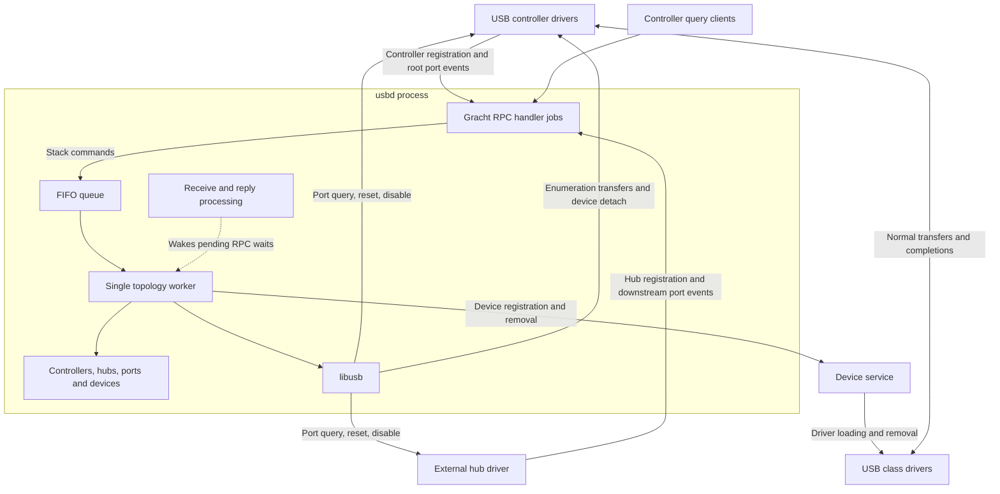

# Architecture and ownership

[Documentation index](README.md)

## Service boundaries

The topology worker is one scheduler job inside usbd, not another process.
It owns topology decisions. Controller drivers own hardware registers, transfer
scheduling, descriptors and DMA mappings. External hub drivers implement port
operations for their downstream ports. The device service manages device
registration and driver loading.

usbd uses libusb for enumeration requests and controller cleanup. Its worker does
not schedule class-driver traffic or manage controller DMA buffers. The shared
USB driver implementation lives under [modules/serial/usb/common](../../../modules/serial/usb/common).

## Protocol boundaries

| Interface | Direction | Purpose |
| --- | --- | --- |
| [sys_usb](../../../protocols/usb.gr) | Drivers/clients to usbd | Register/remove controllers and hubs, report port events/errors, query controllers. |
| [ctt_usbhub](../../../protocols/contracts/usbhub.gr) | usbd to a controller or external hub driver | Query, reset or disable a physical port. |
| [ctt_usbhost](../../../protocols/contracts/usbhost.gr) | libusb clients to controller drivers | Submit transfers, configure hub state and detach devices. |

All eight `sys_usb` operations pass through the topology queue, including the two
controller queries. Registration, removal and event operations have no result
fields. Their internal failures are logged. Queries return a count or a controller
snapshot; they have no error field.

## Execution and ordering

The [Vali Gracht dispatcher](../../../librt/libgracht/runtime/dispatch_vali.c)
creates a scheduler job for each dispatched RPC. The worker setting in the
[service runtime](../../../librt/libcrt/service.c) enables this dispatch path;
it does not make complete RPC handlers execute one at a time. A handler can yield
while waiting for another RPC or a timer.

`__SubmitCommand` appends a command under a short queue mutex. The topology worker
removes commands in that FIFO order and completes each before executing the next.
Order is defined by enqueue order, not by a global ordering of physical events or
messages from different senders. Port events query current hardware status when
processed; they do not carry a saved hardware-status snapshot.

The mutex protects admission, queue links and completion flags. It is released
before core work, outgoing RPC waits or query responses. While enumeration yields,
the receive/reply path continues running and new handlers may enqueue work. No
other topology command executes until that enumeration command returns.

Precondition for core routines: call them from the topology worker. Initialization
runs before protocol registration, and final cleanup runs after a successful
worker join. A new RPC handler must enqueue work rather than access registries
directly. A command running in the worker must not submit another command and wait
for it: that would wait on the same worker.

## Memory and object ownership

| Object | Owner and lifetime |
| --- | --- |
| Decoded RPC arguments and message | RPC dispatch/invocation storage remains valid until the handler returns. |
| `__TopologyCommand` | Stored on the submitting handler's stack. The handler waits for `Done`, even after shutdown closes admission. |
| Queue synchronization | Static service state. Remains valid after join because completed handlers can still be waking. |
| `UsbController_t` | Controller list. Owns converted `Device_t`, its separately allocated identity strings, address bitmap and recovery record. |
| `UsbHub_t` | Stored by value in the hub hash table. Describes parent/controller IDs and owns its allocated port records. |
| `UsbPort_t` | Allocated separately from the hash table; owns its current `UsbPortDevice_t`, if present. |
| `UsbPortDevice_t` | Port-owned enumeration context, device-service ID and identification strings. Freed after device/controller cleanup is attempted. |

Controller registration converts protocol data inside the worker.
`UsbCoreControllerRegister` consumes the converted device on both success and
failure. The RPC argument storage can then be released independently.

Hash-table changes can move hub entries. Recursive hub removal copies the hub
record before changing the table; its separately allocated ports remain valid
until explicitly freed. Do not keep pointers into the table across structural
changes. Serialization prevents another command from changing the table during a
yield, but does not prevent the current command's recursive calls from doing so.

Each controller has its own 128-bit address bitmap. Address zero is permanently
reserved for enumeration; addresses 1 through 127 are allocated to devices.
The per-controller recovery record prevents a later enumeration from reusing
addresses while a failed device might still respond.

## Performance and limits

Enqueue/dequeue is constant time. Commands add no per-command heap allocation or
extra RPC hop: the queue is in-process and commands live on handler stacks.
This does not mean the whole RPC path is allocation-free; Gracht dispatch,
scheduler jobs and enumeration have their own storage costs.

The worker adds a scheduler handoff and completion wait to topology operations.
Slow enumeration delays later topology events and queries, including those for
other controllers. There is no explicit queue-depth limit or event coalescing;
queued handlers keep their stack and RPC storage until completion.

Normal transfer submission and completion bypass this queue. Port isolation RPCs
run only when enumeration recovery is pending. Changing the worker therefore
does not add queue operations to the controller transfer fast paths.
