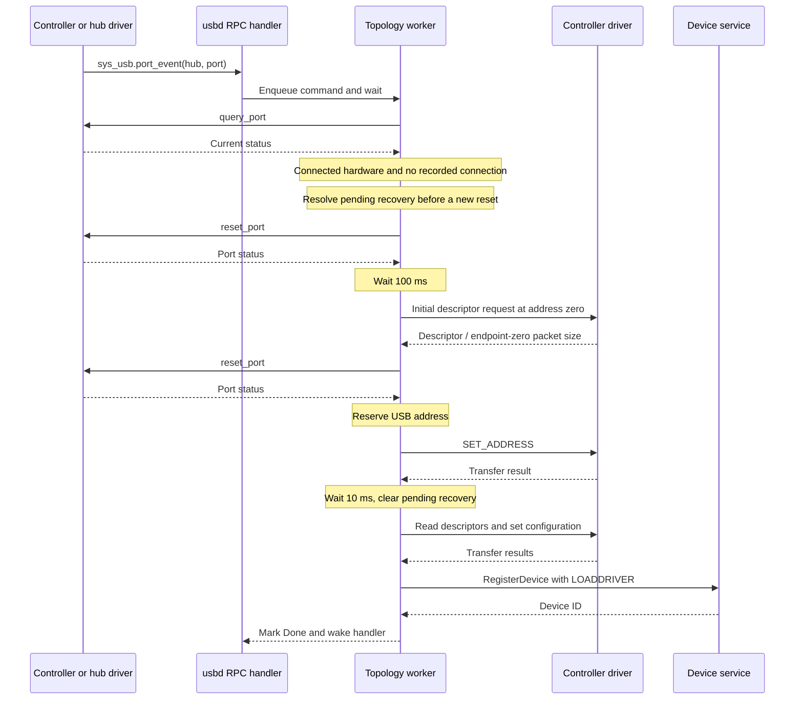

# Common flows

[Documentation index](README.md)

## Controller registration

1. A controller driver sends `sys_usb.register_controller` with its driver handle,
   device description, controller kind and root-port count.
2. The RPC handler enqueues a stack command and waits for completion.
3. The worker converts the device description and creates `UsbController_t`.
4. Address zero is marked reserved. A root hub is registered with the controller's
   device ID as both its own ID and parent ID, using the controller driver for port
   operations.
5. The controller is appended to the registry. The worker completes the command,
   allowing the handler and decoded argument storage to be released.

Conversion/allocation failures are logged. The registration routine frees the
converted device and its identity strings on its failure paths.
See [controllers.c](../controllers.c) and [topology.c](../topology.c).

## Port connection and enumeration

`UsbCorePortEvent` resolves the hub and controller, queries the port, and creates
the port record if needed. It enumerates when hardware reports connected and the
record reports disconnected. A repeated event for an already connected port
updates status without enumerating again.

`UsbCoreDevicesCreate` attaches a new device context to the port and records the
physical port for recovery before resetting it. The first reset must report both
connected and enabled. The initial descriptor request determines endpoint-zero
packet size. After the second reset, the routine reserves an address and sends
`SET_ADDRESS`, retrying once on transfer failure.

After address assignment, the worker reads the full device descriptor,
identification strings and configuration, then sets the selected configuration.
For interface-defined devices, the current code uses the first interface setting
to determine class/subclass. Device registration passes the USB context to the
device service and requests driver loading. The resulting device-service ID is
stored separately from the USB bus address.

Any failure enters the [enumeration recovery flow](recovery-and-lifecycle.md#enumeration-failure).
The diagram describes successful execution, not additional validation or retries
beyond those implemented in [devices.c](../devices.c).

## External hub registration

An external hub is first enumerated as a USB device on its parent port. Its hub
driver then sends `sys_usb.register_hub` with its parent ID, device/driver IDs,
downstream-port count and hub characteristics.

The worker registers the hub, finds its USB address and parent-port position from
the parent hub's device records, and calls `ctt_usbhost.configure_hub` when the hub
has a nonzero USB address. That call supplies controller-side hub information
before the worker processes the next command. Subsequent downstream port events
use the hub driver for port operations and the controller driver for transfers.

Current limit: `UsbCoreHubsRegisterAndConfigure` waits for the configuration RPC,
but does not act on its send/wait/result errors or returned controller status.
Registration is not rolled back on controller configuration failure. The ordering
guarantee therefore means the configuration attempt finishes before the next
command, not that configuration necessarily succeeded.

## Controller queries

Count and indexed snapshot requests are queued with topology mutations. A query
observes state after preceding commands and before following commands. Count and
snapshot are separate commands, so a sequence of client queries is not one atomic
registry snapshot.

An invalid index returns a zeroed `USBControllerDevice_t`. Closed admission returns
zero count or a zeroed snapshot directly from the handler. The snapshot is the
current raw structure format, not a deep serialization of identity strings;
pointer-valued fields do not expose usable remote memory.

## Disconnect, port error and removal

On a disconnect event, `UsbCorePortEvent` queries current status, destroys the
recorded device, and updates the port's status. `UsbCoreDevicesDestroy` performs:

1. `UnregisterDevice` if a device-service ID was assigned.
2. `UsbDetachDevice` while controller and device context still exist.
3. Release the nonzero USB address.
4. Free identification strings and the device object, then clear `port->Device`.

These calls attempt remote cleanup before freeing local state. The current code
does not propagate device-unregistration or controller-detach failures into a
retryable teardown state. `UsbDetachDevice` has a void interface.

A `port_error` command destroys the port's device if present. It does not itself
reset, disable or re-enumerate the port, or clear the connection flags. Do not
interpret it as the enumeration-failure isolation flow.

`unregister_hub` explicitly removes a hub subtree: child hubs are removed before
their parent-port devices, port records are freed, and then the hub entry is
removed. Plain device destruction does not itself walk child hub entries; hub
unregistration is the operation responsible for that subtree cleanup.

`unregister_controller` removes the root hub recursively before removing the
controller from the list. The controller must remain indexed during recursive
cleanup because device teardown needs its driver handle and address map. Finally,
the converted device description, identity strings and controller are freed.
