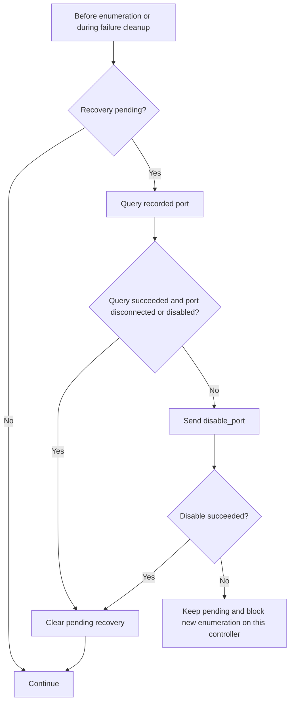

# Recovery and lifecycle

[Documentation index](README.md)

## Enumeration failure

Serial execution protects topology memory and operation order. It does not undo
hardware state left by an unsuccessful reset or control transfer. A device can
remain enabled at address zero, or accept `SET_ADDRESS` even when the caller does
not receive a successful response. Later failures can leave an addressed device
enabled after local setup is abandoned.

`UsbEnumerationRecovery` records the hub driver, hub device and physical port that
must be isolated. `Pending` is set before reset, cleared after successful address
assignment and its recovery delay, and set again on any subsequent setup failure.



`__ClearEnumerationRecovery` implements this check. `disable_port` belongs to
`ctt_usbhub`: the controller driver disables a root port, while the external hub
driver clears the downstream port-enable feature and verifies status. usbd owns
the decision to isolate; the driver owns the hardware operation.

On enumeration failure, the routine tries isolation, releases any reserved address
not yet recorded in the device context, destroys the partial device, and marks
the local port disconnected and disabled. If isolation failed, the address bitmap
may already show the address as free, but `Pending` blocks subsequent enumeration
on that controller before another address can be assigned. Local port flags alone
are not proof of hardware isolation.

A later enumeration attempt rechecks the recorded physical port. Physical
disconnection or a disabled status resolves recovery without another disable
request. Otherwise it retries `disable_port`. There is no separate recovery timer
or automatic replay of a previously rejected port event; progress requires a
later enumeration attempt, normally triggered by another event.

If the recorded hub is removed while recovery remains pending, hub removal moves
the recovery target to that hub's upstream port on its parent. Recursive removal
can move the target toward the root. Deleting a hub's software record does not
prove its downstream hardware has stopped responding.

Relevant code: [devices.c](../devices.c), [hubs.c](../hubs.c),
[libusb port operations](../../../librt/libusb/functions.c),
[root-port service](../../../modules/serial/usb/common/service.c), and
[external hub service](../../../modules/serial/usb/hub/main.c).

## Startup

`ServiceInitialize` calls `UsbCoreInitialize` before publishing `sys_usb`:

1. Initialize the hub registry.
2. Initialize libusb resources.
3. Start the persistent topology worker.
4. Mark the core initialized and register the protocol.

If libusb initialization fails, the hub registry is cleaned up. If worker creation
fails, the registry and initialized libusb resources are cleaned up. Startup does
not publish handlers that could submit to an uninitialized queue. Reinitializing
an already initialized core returns `OS_EBUSY`.

## Shutdown and command lifetime

Preconditions: one lifecycle caller serializes stop through final cleanup; that
caller runs outside the topology worker; the receive/reply path remains active.
Do not restart the worker while lifecycle work or old handlers are still in flight.

```mermaid
sequenceDiagram
    participant Life as Lifecycle caller
    participant Queue as Queue state
    participant Worker as Topology worker
    participant Handler as Accepted handlers
    Life->>Queue: Close admission and wake worker
    Note over Queue: New mutations rejected; queries return empty results
    Life->>Worker: Join without holding queue mutex
    loop Commands accepted before close
        Worker->>Worker: Execute next command, including RPC waits
        Worker->>Handler: Set Done and signal completion
    end
    Worker-->>Life: Exit after queue is empty
    Note over Life: On successful join only
    Life->>Life: Remove controllers and their device trees
    Life->>Life: Free remaining hub/port records
    Life->>Life: UsbCleanup and clear initialized flag
```

An accepted command stays on its handler's stack until `Done` becomes true.
Closing admission, cancellation or a spurious condition wake must not cause the
handler to return early. The worker publishes completion under the queue mutex
and never accesses that command after unlocking. Static queue synchronization
survives join because completed handlers may still need it before returning.

`UsbTopologyStop` rejects self-join with `OS_EBUSY`. A failed join returns
`OS_EUNKNOWN` and leaves the job identifier and topology state available for retry;
admission remains closed. `UsbCoreDestroy` performs no core cleanup on that failure.
After successful cleanup, repeated `UsbCoreDestroy` calls return `OS_EOK`.

Controller cleanup removes entries explicitly. It cannot use `list_clear` with a
callback that unregisters controllers: that callback would remove entries under
the same list lock and may wait for remote cleanup.

Current integration limit: the service runtime has no service-exit callback wired
to `UsbCoreDestroy`. The drain/join path is implemented and tested as an explicit
lifecycle API; automatic graceful process shutdown is not established. Calling it
after stopping reply processing can deadlock pending enumeration or detach RPCs.

## Regression coverage

[usbd_enumeration_test.c](../../../testing/usbd_enumeration_test.c) runs the real
core and worker code with a deterministic fiber scheduler and mocked external
services. It checks allocation cleanup and detects recursive list-lock use.

| Area | Covered behavior |
| --- | --- |
| Ordering | Concurrent/duplicate port events; event, count, snapshot and removal FIFO order. |
| Lifetimes | Registration argument lifetime, independent converted strings, allocation failures, spurious completion wake during shutdown. |
| Recovery | Reset, initial descriptor, address assignment, configuration and device-registration failures; failed isolation blocks the next reset. |
| Addresses | Allocation of all 127 usable addresses, exhaustion and reuse. |
| Removal | Controller removal queued during enumeration, removed-hub recovery target, port error and hub cleanup. |
| Lifecycle | Library/worker startup failures, drain accepted commands, reject late commands, self-stop, join failure/retry and repeated teardown. |

From the repository root on a configured Windows host:

```powershell
./testing/device_dma_test.ps1 -Filter usbd_enumeration_test
```

The runner defaults to the Vali clang installation and an ARM64 Windows host
target. Its `Compiler` and `Target` parameters allow the configured host toolchain
to be selected. Generated protocol headers under `build/windows/protocols` are
required. These tests establish control flow and ownership behavior; real boot
tests are still needed to exercise Gracht scheduling and controller hardware
behavior together.
